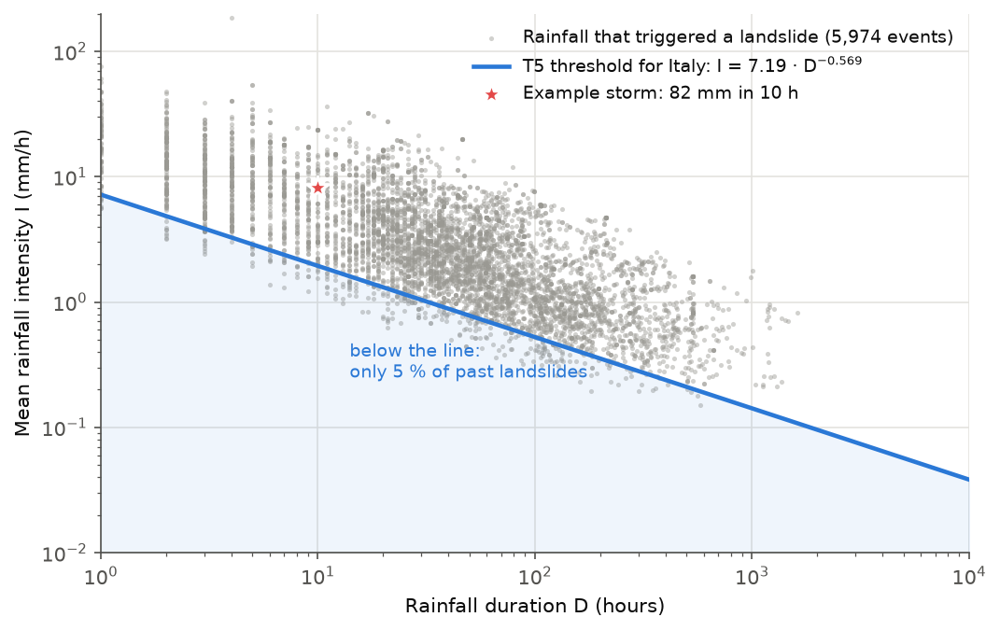
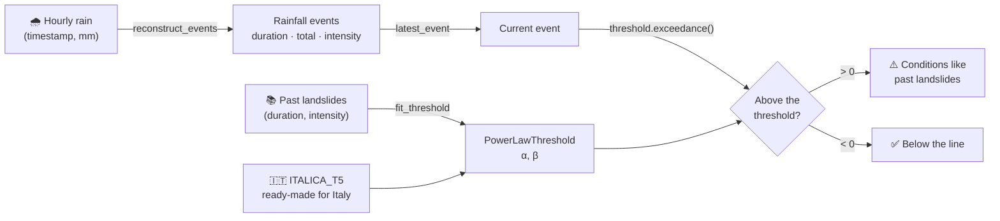
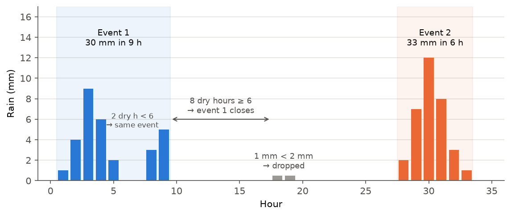
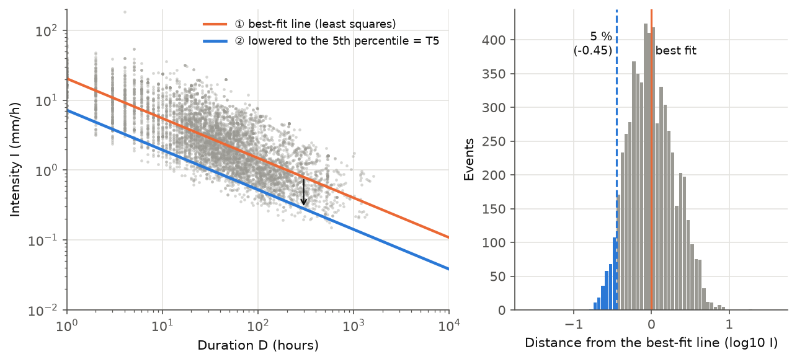
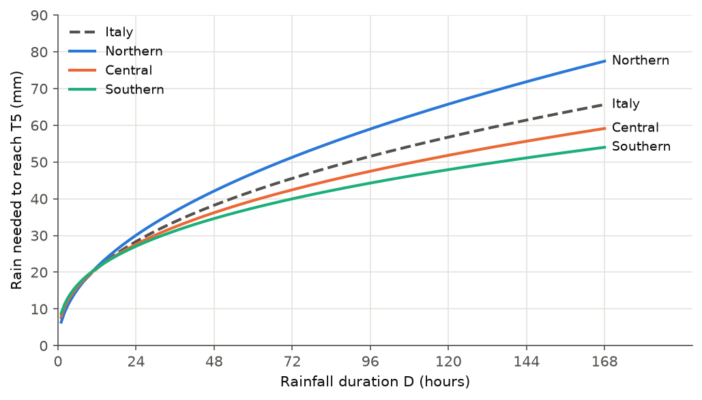

# rainfall-thresholds

**How much rain does it take to set off a landslide?**
A small, dependency-free Python library that answers that question with the
rainfall thresholds used in landslide science: turn an hourly rain-gauge
series into rainfall events, compare them with a threshold, and fit your own
threshold from past landslides. It ships ready-to-use thresholds for Italy,
fitted on 5,974 real landslides.

[](https://github.com/agent-engineering-studio/rainfall-thresholds/actions/workflows/ci.yml)
[](https://pypi.org/project/rainfall-thresholds/)
[](https://pypi.org/project/rainfall-thresholds/)
[](https://github.com/agent-engineering-studio/rainfall-thresholds/blob/main/pyproject.toml)
[](https://github.com/agent-engineering-studio/rainfall-thresholds/blob/main/LICENSE)

<picture>
  <source media="(prefers-color-scheme: dark)" srcset="https://raw.githubusercontent.com/agent-engineering-studio/rainfall-thresholds/main/docs/img/id-plane-dark.png">
  
</picture>

<sub>Every grey dot is a storm that triggered a landslide in Italy (e-ITALICA
catalogue). The blue line is the threshold this library fits: only 5 % of
those storms fall below it. The red star is the storm from the
[quick start](#quick-start).</sub>

---

## Contents

- [The idea in 30 seconds](#the-idea-in-30-seconds)
- [How it works](#how-it-works)
- [Install](#install)
- [Quick start](#quick-start)
- [Step by step](#step-by-step)
  - [1. From hourly rain to rainfall events](#1-from-hourly-rain-to-rainfall-events)
  - [2. Comparing an event with a threshold](#2-comparing-an-event-with-a-threshold)
  - [3. Fitting your own threshold](#3-fitting-your-own-threshold)
- [Thresholds for Italy](#thresholds-for-italy)
- [Recipe: check a rain gauge](#recipe-check-a-rain-gauge)
- [API at a glance](#api-at-a-glance)
- [Good to know](#good-to-know)
- [References](#references) · [Citing](#citing) · [Contributing](#contributing)

## The idea in 30 seconds

Shallow landslides start when the soil gets too wet. What makes it too wet
is a mix of **how hard** it rains and **for how long**:

- a short, violent downpour can do it: 30 mm in 2 hours;
- so can a long, gentle rain: 60 mm over three days.

In 1980 Nels Caine noticed that, on a log-log chart of *duration* against
*mean intensity*, the storms that triggered landslides sit above a straight
line. That line is the **rainfall threshold**:

```
I = α · D^(-β)

I  mean rainfall intensity (mm/h)
D  rainfall duration (hours)
α  how high the line sits     β  how fast it drops with duration
```

Above the line: rain like the rain that triggered landslides in the past.
Below it: rain that very rarely did. That is all a threshold says, and it is
why thresholds are at the heart of many landslide early-warning systems.

This library gives you the three pieces around that line, in plain Python
with no dependencies.

## How it works



| Step | What you have | What you call | What you get |
|---|---|---|---|
| 1 | an hourly rain series | `reconstruct_events`, `latest_event` | rainfall events, each with duration, total and intensity |
| 2 | an event and a threshold | `PowerLawThreshold.intensity` / `.cumulated` / `.exceedance` | how much rain the threshold needs, and how far above or below it you are |
| 3 | a catalogue of landslide-triggering events | `fit_threshold` | your own threshold |

## Install

```bash
pip install rainfall-thresholds
```

Python 3.12 or newer. No dependencies: not even NumPy.

## Quick start

A storm over Calabria, southern Italy: 82 mm in about ten hours. Is it
landslide weather?

```python
from datetime import UTC, datetime, timedelta

from rainfall_thresholds import ITALICA_T5, latest_event, macroregion_of, reconstruct_events

# Hourly rain from a gauge, in mm
start = datetime(2026, 10, 10, tzinfo=UTC)
hourly_mm = [0, 2, 8, 15, 22, 18, 9, 4, 0, 1, 3, 0, 0]
series = [(start + timedelta(hours=h), mm) for h, mm in enumerate(hourly_mm)]

# 1. Cut the series into rainfall events and take the last one
event = latest_event(reconstruct_events(series, no_rain_break_hours=6, min_event_mm=2.0))
assert event is not None

# 2. Pick the threshold for the region
threshold = ITALICA_T5[macroregion_of("Calabria") or "italy"]  # "southern"

# 3. Compare
print(f"{event.total_mm:.0f} mm in {event.duration_hours:.0f} h = {event.intensity_mm_h:.1f} mm/h")
print(f"T5 at that duration: {threshold.intensity(event.duration_hours):.1f} mm/h")
print(f"{threshold.exceedance(event.intensity_mm_h, event.duration_hours):+.2f} decades")
```

```
82 mm in 10 h = 8.2 mm/h
T5 at that duration: 2.0 mm/h
+0.62 decades
```

The storm is about four times as intense as the threshold (10^0.62 ≈ 4.2):
it is the red star in the chart at the top.

## Step by step

### 1. From hourly rain to rainfall events

A rain gauge gives you one number per hour. A threshold needs *events*: a
start, an end, a total. `reconstruct_events` cuts the series with two
simple rules:

- **`no_rain_break_hours`**: this many dry hours in a row end an event;
- **`min_event_mm`**: events with less rain than this are dropped as noise.

An event runs from its first to its last wet hour, so short dry spells
inside a storm stay in the same event.

<picture>
  <source media="(prefers-color-scheme: dark)" srcset="https://raw.githubusercontent.com/agent-engineering-studio/rainfall-thresholds/main/docs/img/event-reconstruction-dark.png">
  
</picture>

```python
events = reconstruct_events(series, no_rain_break_hours=6, min_event_mm=2.0)
for e in events:
    print(e.start, e.end, e.duration_hours, e.total_mm, e.intensity_mm_h)

current = latest_event(events)  # the event that ended last, or None
```

Each event is a frozen `RainfallEvent` with `start`, `end`,
`duration_hours`, `total_mm` and the `intensity_mm_h` property.

> **Tip.** The series should be hourly and without gaps: dry hours count
> only if they are in the series as `0`. If your gauge skips dry hours, fill
> them in before calling `reconstruct_events`.

### 2. Comparing an event with a threshold

A `PowerLawThreshold` answers three questions for an event of a given
duration:

| Method | Question | Unit |
|---|---|---|
| `intensity(D)` | How intense must rain be, on average, to reach the line? | mm/h |
| `cumulated(D)` | How much rain in total must fall to reach the line? | mm |
| `exceedance(I, D)` | How far above (+) or below (−) the line is this event? | decades |

`cumulated` is usually the easiest to talk about. With the threshold for
northern Italy:

```python
from rainfall_thresholds import ITALICA_T5

t = ITALICA_T5["northern"]
for d in (1, 6, 24, 72):
    print(f"{d:>3} h  {t.cumulated(d):5.1f} mm  {t.intensity(d):5.2f} mm/h")
```

```
  1 h    6.4 mm   6.40 mm/h
  6 h   15.3 mm   2.55 mm/h
 24 h   30.0 mm   1.25 mm/h
 72 h   51.3 mm   0.71 mm/h
```

Longer rain needs more water in total, but less per hour.

**Reading `exceedance`.** It is `log10(I / I(D))`, so it is scale-free and
easy to put on a dashboard. Four 24-hour events against the national
threshold (28 mm in 24 h):

| Rain in 24 h | Mean intensity | `exceedance` | In words |
|---:|---:|---:|---|
| 12 mm | 0.5 mm/h | −0.37 | well below the line |
| 24 mm | 1.0 mm/h | −0.07 | just below |
| 58 mm | 2.4 mm/h | +0.31 | twice the threshold intensity |
| 288 mm | 12 mm/h | +1.01 | ten times: an extreme event |

A dry event (zero intensity) gives `-inf`.

### 3. Fitting your own threshold

Have a list of landslides and the rain that triggered them? Fit a threshold
for your own area:

```python
from rainfall_thresholds import fit_threshold

# (duration in hours, mean intensity in mm/h) of rain that triggered landslides
triggering_events = [
    (3, 9.0),
    (5, 4.0),
    (6, 6.5),
    (10, 5.5),
    (12, 3.1),
    (24, 2.4),
    (30, 1.4),
    (48, 1.1),
    (72, 1.0),
    (96, 0.6),
]

fit = fit_threshold(triggering_events, percentile=5)
t = fit.threshold
print(f"T5: I = {t.alpha:.2f} · D^-{t.beta:.3f}   ({fit.n_events} events)")
print(f"at 24 h: {t.intensity(24):.2f} mm/h, i.e. {t.cumulated(24):.0f} mm")
```

```
T5: I = 14.78 · D^-0.737   (10 events)
at 24 h: 1.42 mm/h, i.e. 34 mm
```

(Ten events are enough for an example, not for a real threshold: published
thresholds use hundreds.)

What `fit_threshold` does, in two steps:

1. **Best-fit line.** Least squares on `log I` against `log D` through all
   the events: the orange line below, returned as `fit.central`.
2. **Lower it.** Slide the line down, keeping its slope, until only
   `percentile` % of the events sit beneath it: the blue line, returned as
   `fit.threshold`. With `percentile=5` this is the **T5** threshold.

<picture>
  <source media="(prefers-color-scheme: dark)" srcset="https://raw.githubusercontent.com/agent-engineering-studio/rainfall-thresholds/main/docs/img/fitting-dark.png">
  
</picture>

This is the frequentist method of Brunetti et al. (2010) and Peruccacci et
al. (2012), with one difference: they take the percentile from a Gaussian
fitted to a kernel density of the residuals; this package takes it straight
from the residuals. The two agree when the residuals are close to normal,
and the empirical one makes no assumption about their shape.

## Thresholds for Italy

`ITALICA_T5` holds four T5 thresholds fitted with `fit_threshold(percentile=5)`
on the 5,974 events of [e-ITALICA](https://doi.org/10.5281/zenodo.14204473)
v4 with a positive duration and cumulated rainfall:

| Key | α (mm/h) | β | Events | Rain needed in 24 h | in 72 h |
|---|---:|---:|---:|---:|---:|
| `"italy"` | 7.193 | 0.5685 | 5,974 | 28.3 mm | 45.5 mm |
| `"northern"` | 6.400 | 0.5134 | 2,659 | 30.0 mm | 51.3 mm |
| `"central"` | 7.953 | 0.6085 | 1,890 | 27.6 mm | 42.4 mm |
| `"southern"` | 8.754 | 0.6449 | 1,425 | 27.1 mm | 40.0 mm |

<picture>
  <source media="(prefers-color-scheme: dark)" srcset="https://raw.githubusercontent.com/agent-engineering-studio/rainfall-thresholds/main/docs/img/macroregions-dark.png">
  
</picture>

For short bursts the regions behave alike; over days, the north needs
noticeably more rain than the south before landslides start.

Pick the threshold from the region name with `macroregion_of`:

```python
from rainfall_thresholds import ITALICA_T5, macroregion_of

macroregion_of("Liguria")  # "northern"
macroregion_of("Abruzzo")  # "central"
macroregion_of("Bavaria")  # None: not an Italian region

threshold = ITALICA_T5[macroregion_of("Sicilia") or "italy"]
```

> **Abruzzo and Molise are in the centre**, unlike the ISTAT "Sud". Use
> `macroregion_of` (or `MACROREGIONS`) rather than an ISTAT table, or the
> threshold will not be the one fitted on that region's landslides.

These numbers are **reproducible, not copied**: the catalogue ships with the
tests and `tests/test_italy.py` refits all four thresholds from it on every
run. They are not the thresholds published by the e-ITALICA authors, who use
their own method and partitions; they are what this package's method gives
on their data.

## Recipe: check a rain gauge

Read an hourly CSV, find the current rainfall event and see where it stands:

```python
import csv
from datetime import datetime

from rainfall_thresholds import ITALICA_T5, latest_event, macroregion_of, reconstruct_events

with open("gauge.csv", encoding="utf-8") as f:  # columns: time, rain_mm
    series = [(datetime.fromisoformat(r["time"]), float(r["rain_mm"])) for r in csv.DictReader(f)]

event = latest_event(reconstruct_events(series, no_rain_break_hours=6, min_event_mm=2.0))
threshold = ITALICA_T5[macroregion_of("Liguria") or "italy"]

if event is None:
    print("No rain event in the window")
else:
    e = threshold.exceedance(event.intensity_mm_h, event.duration_hours)
    needed = threshold.cumulated(event.duration_hours)
    print(
        f"{event.start:%d %b %H:%M} → {event.end:%H:%M}: {event.total_mm:.0f} mm "
        f"(T5 needs {needed:.0f} mm in {event.duration_hours:.0f} h) → {e:+.2f}"
    )
```

```
10 Oct 01:00 → 07:00: 78 mm (T5 needs 16 mm in 7 h) → +0.67
```

Run it every hour on the last few days of data and you have the rainfall
part of a simple monitoring loop.

## API at a glance

| Name | Kind | What it is |
|---|---|---|
| `PowerLawThreshold(alpha, beta)` | frozen dataclass | `I = α·D^(-β)`, with `.intensity(D)`, `.cumulated(D)`, `.exceedance(I, D)` |
| `reconstruct_events(series, *, no_rain_break_hours, min_event_mm)` | function | hourly `(datetime, mm)` pairs → `list[RainfallEvent]` |
| `latest_event(events)` | function | the event that ended last, or `None` |
| `RainfallEvent` | frozen dataclass | `start`, `end`, `duration_hours`, `total_mm`, `.intensity_mm_h` |
| `fit_threshold(events, *, percentile=5.0)` | function | `(D, I)` pairs → `ThresholdFit` |
| `ThresholdFit` | frozen dataclass | `threshold`, `central`, `percentile`, `n_events` |
| `percentile_of(values, percentile)` | function | linear-interpolation percentile, same as NumPy's default |
| `ITALICA_T5` | read-only mapping | `"italy"`, `"northern"`, `"central"`, `"southern"` → `PowerLawThreshold` |
| `MACROREGIONS` | read-only mapping | macroregion → set of region names (e-ITALICA spelling) |
| `macroregion_of(region)` | function | region name → macroregion, or `None` |

Everything is fully typed (`py.typed`) and checked with `mypy --strict`.

## Good to know

- **A threshold is not a forecast.** Rain above T5 means "conditions like
  those that triggered landslides before", not "a landslide will happen
  here". Slope, soil, vegetation and antecedent wetness all matter. Use it
  as one input to a warning system, alongside expert judgement.
- **T5 is deliberately low.** By construction, 95 % of past triggering
  events sit above it: it favours catching events over avoiding false
  alarms.
- **Event reconstruction is simplified.** It follows Melillo et al. (2018),
  whose CTRL-T tool also varies the dry gap with the season. The e-ITALICA
  durations come from that fuller procedure, so applying the Italian
  thresholds to events from `reconstruct_events` mixes the two: fine for
  monitoring, worth knowing for a study.
- **Units are fixed:** hours, millimetres, millimetres per hour.

## Where it's used

Extracted from [Limen](https://github.com/agent-engineering-studio/limen),
which uses it for the rainfall component of its landslide score. Using it
somewhere else? [Open an issue](https://github.com/agent-engineering-studio/rainfall-thresholds/issues)
and tell us: we'd love to list it here.

## References

- Caine N. (1980). The rainfall intensity-duration control of shallow
  landslides and debris flows. *Geografiska Annaler A* 62, 23-27.
- Brunetti M.T. et al. (2010). Rainfall thresholds for the possible
  occurrence of landslides in Italy. *NHESS* 10, 447-458.
- Peruccacci S. et al. (2012). Lithological and seasonal control on
  rainfall thresholds for the possible initiation of landslides in central
  Italy. *Geomorphology* 139-140, 79-90.
- Melillo M. et al. (2018). A tool for the automatic calculation of
  rainfall thresholds for landslide occurrence. *Environmental Modelling &
  Software* 105, 230-243.
- Peruccacci S. et al. (2023). ITALICA: an ITAlian rainfall-induced
  LandslIdes CAtalogue. *ESSD* 15, 2863-2877.
- Brunetti M.T. et al. (2024). e-ITALICA (enhanced ITAlian rainfall-induced
  LandslIdes CAtalogue), v4. Zenodo,
  [doi:10.5281/zenodo.14204473](https://doi.org/10.5281/zenodo.14204473).

## Citing

If this library helps your work, please cite the method and data papers
above, and link to this repository:

```
Zileni G. rainfall-thresholds: rainfall intensity-duration thresholds for
shallow landslides (Python). https://github.com/agent-engineering-studio/rainfall-thresholds
```

## Contributing

Issues and pull requests are welcome: new regional thresholds, better event
reconstruction, examples from other countries. See
[CONTRIBUTING.md](https://github.com/agent-engineering-studio/rainfall-thresholds/blob/main/CONTRIBUTING.md). To set up and run the checks:

```bash
uv sync
make check     # ruff, mypy --strict, pytest with 100 % coverage
make figures   # redraw the README charts (docs/make_figures.py)
```

⭐ If you find it useful, a star helps others find it.

## Data licence

The test fixture `tests/fixtures/italica_v4_dur_rain.csv` is e-ITALICA v4
(Brunetti et al. 2024), [CC BY 4.0](https://creativecommons.org/licenses/by/4.0/),
reduced to four columns (id, region, duration, cumulated rainfall). The
charts in `docs/img/` are drawn from it.

## License

Code: [Apache-2.0](https://github.com/agent-engineering-studio/rainfall-thresholds/blob/main/LICENSE).
