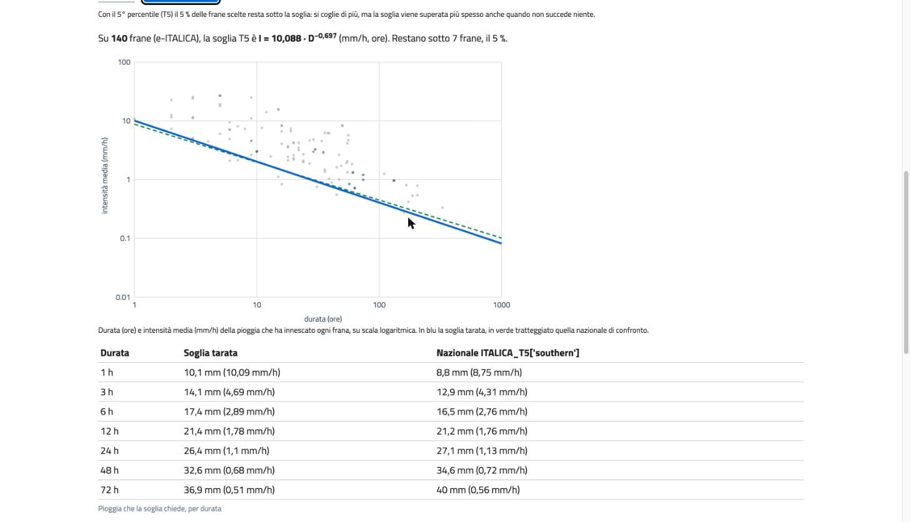

# Examples

## Notebooks

Five notebooks in [`notebooks/`](https://github.com/agent-engineering-studio/rainfall-thresholds/tree/main/notebooks),
saved with their outputs.

- [**1 · The Italian thresholds**](https://github.com/agent-engineering-studio/rainfall-thresholds/blob/main/notebooks/01_italian_thresholds.ipynb):
  the four T5 thresholds in millimetres, which region gets which, and the
  5,974 e-ITALICA landslides under the lines (299 below the national one,
  5.0 %).
- [**2 · The Melito storm**](https://github.com/agent-engineering-studio/rainfall-thresholds/blob/main/notebooks/02_melito_storm.ipynb):
  10 October 2026 on the DPC radar, 165.7 mm in 35 hours, +0.73 decades; the
  strongest event and the last one; hours not measured.
- [**3 · Fit your own threshold**](https://github.com/agent-engineering-studio/rainfall-thresholds/blob/main/notebooks/03_fit_your_threshold.ipynb):
  T5 on the 1,603 landslides of Liguria (32.5 mm in 24 hours), and how the
  percentile moves it.
- [**4 · Radar rain on dated landslides**](https://github.com/agent-engineering-studio/rainfall-thresholds/blob/main/notebooks/04_radar_on_dated_landslides.ipynb):
  the join with the sister libraries, ispra-idrogeo and dpc-radar, as Limen
  does it. A landslide dated to the day takes the end of its day (the next
  local midnight in Europe/Rome). Needs the network.
- [**5 · How much to trust the line, and how much rain is still missing**](https://github.com/agent-engineering-studio/rainfall-thresholds/blob/main/notebooks/05_trust_and_margin.ipynb):
  the share of each region's landslides below the line, from 1.3 % in
  Calabria to 16.2 % in Valle d'Aosta, with the interval; the rain still
  missing hour by hour during the storm of Melito; the published thresholds
  of Calabria, Abruzzo-Marche-Umbria and Sicilia; the record.

All but the fourth need no network and run in CI.

```bash
uv run --group examples jupyter lab notebooks/
docker compose up notebooks    # the same, with Docker alone: http://localhost:8881
```

## The calibration bench

A page in Italian for a public body, in [`app/`](https://github.com/agent-engineering-studio/rainfall-thresholds/tree/main/app):
it fits a threshold on the e-ITALICA landslides of its region, or on its own,
compares it with the national one, measures its cost on the body's own rain
gauge and exports it. [Riuso nella PA](riuso.md) says what it does and what
stays with the body.

```bash
TARATURA_ENTE="Comune di Gioia del Colle" TARATURA_REGIONE=Puglia docker compose up taratura
# http://localhost:3001
```



## Try it

[An interactive intensity-duration plane](explainer.md), in the browser.
